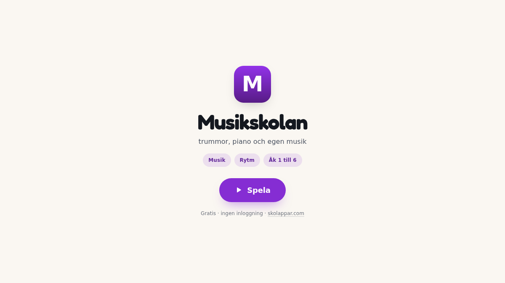

# Musikskolan

Musikskolan låter barn i åk 1–6 spela trummor, piano och gitarr, mixa färdiga slingor och
bygga egna låtar direkt i webbläsaren. Den har också korta lektioner, notläsning och
gehörsträning. Allt ljud skapas i webbläsaren med Tone.js, och det behövs inget konto.

**Spela:** https://musiken.skolappar.com · En del av [Skolappar](https://www.skolappar.com) – pedagogiska appar av föräldrar · öppen källkod (MIT)



Körs fristående.

## Vad du kan göra

- **Trumrummet**: bygg ett beat i ett rutnät med 8 trumljud × 16 steg och tre tempon
  (lugn, normal, snabb). Beatet kan sparas.
- **Pianoparken**: spela Do–Do på ett färgkodat piano, spara melodin eller spela *Rytm Hero*.
- **Gitarrgläntan**: spela fritt på strängarna eller spela *Gitarr Hero*.
- **Mixerstudion**: välj en slinga per spår (trummor, bas, melodi, effekter), mixa volymen
  och spara mixen.
- **Låtbyggaren**: lägg ihop delar som intro, vers, refräng, brygga och slut (upp till 10),
  välj tempo, spela upp och spara.
- **Mitt Rum**: dina sparade låtar, stjärnor och märken.
- **Dagens lektion**: åtta korta lektioner, från höga och låga toner till hela skalan,
  med stjärnor och en räknare för dagar i rad.
- **Notskolan**: läs noter på notraderna i fyra nivåer.
- **Gehörslabbet**: högt eller lågt, samma eller olika, och gissa den hemliga tonen.

## Kom igång

```bash
npm install
npm run dev        # utvecklingsserver
npm run build      # produktionsbygge till dist/
npm run build:dev  # bygge i utvecklingsläge
npm run preview    # förhandsgranska bygget
npm run lint       # eslint
```

Docker-bygget använder Node 22.

## Docker

```bash
docker build -t musikskolan .
docker run --rm -p 8080:8080 musikskolan
```

Bygget serveras av nginx med `deploy/nginx.conf`.

## Integritet

- Inget konto, ingen inloggning, inga kakor och ingen analys.
- Inga anrop till externa servrar. Allt ljud syntetiseras lokalt med Tone.js.
- Typsnittet Fredoka följer med appen (`public/fonts/`). Nunito ligger också med som reserv.
- Det enda som sparas finns i `localStorage`:
  - `musicmaker-progress`: stjärnor, märken och sparade låtar
  - `musikskolan-lessons`: klara lektioner och antal dagar i rad

  Rensa webbläsardata så är det borta.

## Struktur

```
index.html                startskärm, metadata
src/
  App.tsx                 routes för alla rum
  pages/                  ett rum per sida (DrumRoom, PianoPark, GuitarGlade,
                          MixerStudio, SongBuilder, MyRoom, Lessons, NoteSchool, EarTraining)
  components/music/       piano, gitarr, trumpad, beatrutnät, rytmspel, mixerspår
  components/learn/       notrader, quizmotor och övningssida
  hooks/useAudio.ts       alla ljud via Tone.js
  hooks/useGameProgress.ts  stjärnor, märken, sparade låtar (localStorage)
  lib/quiz.ts             frågegenerator för lektioner, noter och gehör
  lib/lessons.ts          dagens lektioner och räknaren för dagar i rad
deploy/nginx.conf         nginx-konfiguration för containern
```

## Licens

MIT – se [LICENSE](LICENSE).
